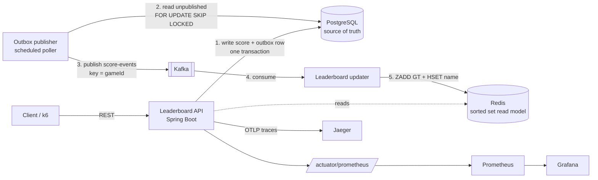

# BUILD_SPEC.md — Player Session & Leaderboard Microservice

> **For Claude Code.** Read this whole file before touching anything. Execute the milestones in order (section 16). Do not skip gates. Do not invent results.
> **For Tejesh.** Put this file in an empty folder on your X drive, open Claude Code there, and say:
> *"Read BUILD_SPEC.md fully, run the preflight (section 3), tell me what you found, then build milestone by milestone."*

---

## 0. Prime directives

1. **Everything lives on the X drive.** C: is full. Project, Maven repo, temp files, Docker disk image: all on X:. Never write large files to C:. Never delete anything on C: or prune Docker without asking Tejesh first.
2. **Every claim must be true.** This project goes on a resume for the EA EADP Java SE Intern role and Tejesh will be interviewed on it. Every technology named in the README or on the resume must exist in the repo and work. Every number (coverage, req/s, latency) must be **measured**, with raw evidence saved under `docs/evidence/`. If something cannot run (for example Docker is down), **stop and report it**. Never fake output, never lower a threshold to make a gate pass.
3. **Tejesh must be able to defend every file.** After each milestone, print a plain-English explanation of at most 10 lines: what was built, why, and one likely interview question with its answer.
4. **Small, meaningful commits** (one per milestone or sub-step, imperative messages such as `Add transactional outbox publisher`). No giant "initial commit". Recruiters read the git history.
5. **Stay in scope.** Build what this file says. Section 19 lists optional stretch items; do them only after section 17 is fully green.
6. If anything in this file is wrong for the real environment (a version does not exist, an artifact was renamed), **verify against the actual registry or docs**, fix it, and note the deviation in `docs/DESIGN.md` under "Deviations from the spec".

---

## 1. Why this project

Target role: **EADP Java SE Intern, EA, Hyderabad.** Requirements from the posting and how this project answers each:

| Posting requirement | Where it shows up |
|---|---|
| Build and deploy new microservices | Spring Boot service, Dockerfile, Compose, CI |
| Code quality, testability, automated test coverage | JUnit 5, Mockito, Testcontainers, JaCoCo gate in CI |
| Troubleshoot cloud-native apps for performance and scale | k6 load test, measured p99, bottleneck notes in `docs/PERFORMANCE.md` |
| Observability, metrics, traces, telemetry | Micrometer + Prometheus, Grafana dashboard, OpenTelemetry traces to Jaeger, structured logs with trace IDs |
| Object-oriented design, design patterns | Ports and adapters, Repository, Strategy, Builder, Transactional Outbox |
| SQL and NoSQL | PostgreSQL (source of truth) + Redis (read model) |
| Large-scale, low-latency distributed systems | Event-driven read model, Redis sorted sets, Kafka partitioning by game |
| Docker, CI/CD, Git | Multi-stage Dockerfile, Compose, GitHub Actions, clean history |
| Communicate progress | README, DESIGN.md, short milestone summaries |

The wider EADP postings also name Kafka, Redis, Prometheus/Grafana, Spring Boot and gRPC. Kafka, Redis, Prometheus/Grafana and Spring Boot are in scope; gRPC is optional (section 19).

---

## 2. Environment and disk constraints (Windows, C: is full)

Tejesh uses Windows (PowerShell). Assume nothing about what is installed until the preflight says so.

**Project location:** `X:\player-leaderboard-service` (use the actual folder this file is in).

**Redirect everything heavy to X:** (run in the PowerShell session you build from; do not commit machine-specific paths)

```powershell
New-Item -ItemType Directory -Force X:\.m2\repository, X:\tmp, X:\docker | Out-Null
$env:MAVEN_ARGS      = "-Dmaven.repo.local=X:\.m2\repository"
$env:MAVEN_USER_HOME = "X:\.m2"          # Maven wrapper distribution cache; verify it is honoured
$env:TEMP = "X:\tmp"; $env:TMP = "X:\tmp"
$env:GRADLE_USER_HOME = "X:\.gradle"     # only if Gradle gets used anywhere
```

After the first `mvnw` run, check that C: did not grow: look at `C:\Users\<user>\.m2` and compare sizes. If it still wrote there, fix it and tell Tejesh.

**Docker Desktop (WSL2 backend) stores its disk image on C: by default.** Ask Tejesh to change it: *Docker Desktop → Settings → Resources → Advanced → Disk image location → `X:\docker`*, then apply and restart. If that setting is not available, fall back to exporting and importing the `docker-desktop` WSL distro to X:. Walk him through it. Do not run `docker system prune` or `docker image prune -a` without explicit permission, because he may have other images.

**Footprint (rough estimate, measure it):** all images pulled for this project plus the Maven cache come to about 3–5 GB. To keep RAM and disk down, Compose uses **profiles**:

- default services: `postgres`, `redis`, `kafka` (infrastructure only, for running the app from the IDE or `mvnw spring-boot:run`)
- `app` profile: adds the service container
- `observability` profile: adds `prometheus`, `grafana`, `jaeger`

Set explicit memory limits (Kafka heap `-Xmx512m`, Redis `maxmemory 128mb`).

Add a `.gitattributes` with `* text=auto` and `*.sh text eol=lf` so Windows line endings do not break the Docker build or shell scripts. Use the **Maven wrapper** (`mvnw`, `mvnw.cmd`) so no global Maven is needed.

---

## 3. Preflight (run first, report results, then continue)

```powershell
java -version                 # need 17 or newer; the project targets Java 17 (<java.version>17</java.version>)
git --version
docker version                # the daemon must respond, not only the client
docker compose version
docker info --format "{{.DockerRootDir}} {{.OperatingSystem}}"
Get-PSDrive C, X              # free space on both
gh --version; gh auth status  # GitHub CLI present and logged in? (needed to create the repo in M0)
```

Report: Java version, whether Docker's daemon is running, free space on X:, and where Docker stores its data. Stop and ask Tejesh if any of these hold:

- Docker's daemon is unreachable (Testcontainers cannot run without it)
- X: has under 8 GB free
- Java is older than 17

Run `git config user.name` and `git config user.email`; if unset, ask Tejesh for them. Do not guess an identity.

---

## 4. Architecture



Design intent:

- **PostgreSQL is the source of truth.** Redis is a rebuildable read model.
- **Transactional outbox** avoids the dual-write problem: the score row and the outbox row commit atomically, and a poller publishes afterwards. Delivery is **at-least-once**.
- **The consumer is idempotent**, so redelivery is harmless. `ZADD ... GT` only ever raises a player's best score.
- **Consistency model:** eventual for the leaderboard (measure and expose the lag), strong for the score write.

---

## 5. Stack (pin versions; verify they exist before using)

| Area | Choice |
|---|---|
| Language | Java 17 (`--release 17`) |
| Framework | Spring Boot, latest stable 3.5.x (verify on start.spring.io; if you use a different line, note it in DESIGN.md) |
| Build | Maven + wrapper |
| DB | PostgreSQL 16 (pin the exact image tag), Flyway migrations, Spring Data JPA (or JdbcTemplate for the outbox queries) |
| Cache / read model | Redis 7 (`ZADD GT` needs Redis 6.2+), Spring Data Redis with Lettuce |
| Messaging | Apache Kafka in KRaft mode (single node, `apache/kafka` pinned tag), Spring for Apache Kafka |
| Observability | Micrometer, `micrometer-registry-prometheus`, `micrometer-tracing-bridge-otel`, OTLP exporter, Prometheus, Grafana, Jaeger all-in-one |
| Tests | JUnit 5, Mockito, AssertJ, Awaitility, Testcontainers (use the Boot-managed BOM version and `@ServiceConnection`; check the actual module names for that version rather than assuming) |
| Coverage | JaCoCo with a `check` rule |
| Load test | k6 run via `docker run grafana/k6` (nothing to install) |
| CI | GitHub Actions |
| Formatting (recommended) | Spotless with google-java-format, enforced in CI |

Base package: `dev.tejesh.leaderboard`. Artifact: `player-leaderboard-service`.

Never use `:latest` image tags.

---

## 6. Data model (Flyway `V1__init.sql`)

```sql
CREATE TABLE players (
  id          UUID PRIMARY KEY,
  username    VARCHAR(32) NOT NULL UNIQUE,
  created_at  TIMESTAMPTZ NOT NULL DEFAULT now()
);

CREATE TABLE game_sessions (
  id          UUID PRIMARY KEY,
  player_id   UUID NOT NULL REFERENCES players(id),
  game_id     VARCHAR(64) NOT NULL,
  status      VARCHAR(16) NOT NULL CHECK (status IN ('ACTIVE','ENDED')),
  started_at  TIMESTAMPTZ NOT NULL DEFAULT now(),
  ended_at    TIMESTAMPTZ
);
CREATE INDEX idx_sessions_player ON game_sessions(player_id);

CREATE TABLE scores (
  id               UUID PRIMARY KEY,                 -- also the event id
  player_id        UUID NOT NULL REFERENCES players(id),
  session_id       UUID NOT NULL REFERENCES game_sessions(id),
  game_id          VARCHAR(64) NOT NULL,
  points           INTEGER NOT NULL CHECK (points >= 0),
  idempotency_key  VARCHAR(64) NOT NULL UNIQUE,
  submitted_at     TIMESTAMPTZ NOT NULL DEFAULT now()
);
CREATE INDEX idx_scores_game_player ON scores(game_id, player_id);

CREATE TABLE outbox_events (
  id            UUID PRIMARY KEY,
  topic         VARCHAR(128) NOT NULL,
  event_key     VARCHAR(128) NOT NULL,
  payload       JSONB NOT NULL,
  created_at    TIMESTAMPTZ NOT NULL DEFAULT now(),
  published_at  TIMESTAMPTZ
);
CREATE INDEX idx_outbox_unpublished ON outbox_events(created_at) WHERE published_at IS NULL;
```

---

## 7. API contract (`/api/v1`, JSON, errors as RFC 7807 `ProblemDetail`)

| Method and path | Behavior |
|---|---|
| `POST /players` `{username}` | 201 with the player. 409 if the username is taken. Username 3–32 chars, `[A-Za-z0-9_]`. |
| `GET /players/{id}` | 200 or 404. |
| `POST /sessions` `{playerId, gameId}` | 201, status `ACTIVE`. 404 if the player is unknown. |
| `POST /sessions/{id}/end` | 200 `ENDED`. Idempotent: ending an ended session returns 200 with the same state. |
| `POST /scores` + header `Idempotency-Key` + `{playerId, sessionId, points}` | 201 on first submit. **Same key again returns 200 with the original score and writes nothing new.** 409 if the session is not ACTIVE or does not belong to the player. 400 on bad input. `gameId` comes from the session. |
| `GET /leaderboards/{gameId}/top?limit=10` | Top N by best score, `limit` 1–100 (default 10). Returns `[{rank, playerId, username, score}]`. |
| `GET /leaderboards/{gameId}/players/{playerId}` | `{rank, score}` or 404 if the player is not on the board. |
| `POST /admin/leaderboards/{gameId}/rebuild` | Rebuilds the Redis board from PostgreSQL (`MAX(points)` per player). Builds into a temp key, then atomic `RENAME`. Returns the count rebuilt. |
| `GET /actuator/health` | Liveness and readiness probes enabled. |
| `GET /actuator/prometheus` | Metrics. |

Leaderboard semantics: a player's rank is based on their **best** score in that game. Ties are broken by Redis's lexicographic member order. Document this in DESIGN.md.

---

## 8. Event flow details

**Score write (single DB transaction):**
1. Validate the session (ACTIVE, owned by the player).
2. `INSERT INTO scores ... ON CONFLICT (idempotency_key) DO NOTHING`. If nothing was inserted, load and return the existing score with 200.
3. Insert an `outbox_events` row: topic `score-events`, key `gameId`, payload `{eventId, playerId, username, gameId, points, submittedAt}`. `username` is denormalized into the event so the consumer needs no DB access.

**Outbox publisher** (`@Scheduled`, fixed delay about 200 ms, configurable):
```sql
SELECT id, topic, event_key, payload FROM outbox_events
WHERE published_at IS NULL ORDER BY created_at
LIMIT 100 FOR UPDATE SKIP LOCKED;
```
Inside one transaction: send each record with `KafkaTemplate`, wait for the ack with a timeout, then set `published_at = now()` for the acked ones. Multiple instances can run concurrently because of `SKIP LOCKED`. Producer config: `acks=all`, `enable.idempotence=true`. If a send fails, leave the row unpublished and increment a failure metric.

**Kafka:** topic `score-events`, 6 partitions, key = `gameId` (per-game ordering). Create it via a `NewTopic` bean. The consumer group is `leaderboard-updater`. Error handling: `DefaultErrorHandler` with exponential backoff (3 retries), then `DeadLetterPublishingRecoverer` to `score-events.DLT`. Use a typed JSON deserializer with a trusted package list; do not use a wildcard `*`.

**Consumer → Redis** (key `leaderboard:{gameId}` as a ZSET, hash `leaderboard:names` for usernames). Use a Lua script via `RedisScript` so both writes are one atomic step:
```lua
redis.call('ZADD', KEYS[1], 'GT', ARGV[1], ARGV[2])   -- score, playerId
redis.call('HSET', KEYS[2], ARGV[2], ARGV[3])         -- playerId, username
return 1
```
`GT` makes redelivery and out-of-order delivery harmless, so there is no separate dedupe store.

**Reads:** `ZREVRANGE ... WITHSCORES`, then one `HMGET` for the usernames (pipeline both). No DB access on the read path. Hide Redis behind a port: `interface LeaderboardStore` with `RedisLeaderboardStore` (Strategy / ports-and-adapters). Unit tests use a fake implementation.

**Rebuild:** as in section 7. Write an integration test: wipe Redis, call rebuild, assert the board matches the DB.

---

## 9. Project structure

```
player-leaderboard-service/
├─ BUILD_SPEC.md
├─ README.md
├─ pom.xml, mvnw, mvnw.cmd, .mvn/
├─ Dockerfile, .dockerignore, .gitignore, .gitattributes
├─ docker-compose.yml
├─ .github/workflows/ci.yml
├─ src/main/java/dev/tejesh/leaderboard/
│  ├─ LeaderboardApplication.java
│  ├─ player/       (Player, PlayerRepository, PlayerService, PlayerController, DTOs)
│  ├─ session/      (GameSession, SessionService, SessionController, ...)
│  ├─ score/        (Score, ScoreService, ScoreController, ScoreSubmittedEvent)
│  ├─ outbox/       (OutboxEvent, OutboxRepository, OutboxPublisher)
│  ├─ leaderboard/  (LeaderboardStore port, RedisLeaderboardStore, LeaderboardService, controller, LeaderboardEventConsumer, RebuildService)
│  ├─ config/       (Kafka, Redis, topics, metrics)
│  └─ web/          (GlobalExceptionHandler -> ProblemDetail)
├─ src/main/resources/ (application.yml, db/migration/V1__init.sql, logback-spring.xml)
├─ src/test/java/... (unit *Test, integration *IT with a shared Testcontainers base)
├─ ops/prometheus/prometheus.yml
├─ ops/grafana/provisioning/{datasources,dashboards}/ and dashboards/leaderboard.json
├─ loadtest/k6-leaderboard.js
├─ scripts/smoke.ps1 (and smoke.sh)
└─ docs/ (DESIGN.md, PERFORMANCE.md, RESUME_NUMBERS.md, evidence/)
```

Use Java records for DTOs and events. Constructor injection only. Keep controllers thin and put business rules in services.

---

## 10. Observability

- `application.yml`: expose `health,info,prometheus,metrics`; enable `probes`; `management.metrics.distribution.percentiles-histogram.http.server.requests=true`; tracing sampling 1.0 by default and configurable by environment variable; OTLP endpoint configurable.
- **Custom metrics:** `leaderboard.scores.submitted` (counter), `leaderboard.read.duration` (timer with histogram), `outbox.pending` (gauge from a count query), `outbox.publish.failures` (counter), `leaderboard.consumer.processed` and `leaderboard.consumer.deadlettered` (counters). **No high-cardinality tags** (no playerId or sessionId).
- Kafka client metrics through Micrometer (consumer lag).
- **Logs:** include `traceId` and `spanId` in the log pattern; JSON logs under a `docker` profile.
- **Grafana dashboard** (provisioned as JSON, no manual clicking). Panels: request rate, p50/p95/p99 latency per endpoint, error rate, outbox pending, consumer lag, JVM heap and GC, Hikari connection pool.
- Confirm in Jaeger that one `POST /scores` shows a trace through the controller, the DB and the Kafka send. Save a screenshot to `docs/evidence/`.

---

## 11. Testing (real tests, not padding)

- **Unit** (`*Test`, no Spring context, fast): service rules (session ownership, idempotency branch, ACTIVE check), event mapping, outbox batch logic with mocks, a leaderboard service with a fake `LeaderboardStore`.
- **Web slice** (`@WebMvcTest`): validation errors, 404/409 mapping to `ProblemDetail`, limit bounds.
- **Integration** (`*IT`, Testcontainers PostgreSQL + Redis + Kafka, shared containers through a base class so they start once):
  1. Submit a score → `Awaitility` waits until `GET top` shows it (full outbox → Kafka → Redis path).
  2. Same `Idempotency-Key` twice → one row, one event.
  3. Lower score after a higher one → rank and score unchanged (`GT`).
  4. Consumer redelivery of the same event → no change.
  5. Rebuild after wiping Redis → matches the DB.
  6. Poison message → lands in `score-events.DLT` and the consumer keeps working.
  7. Two concurrent submits with the same key → exactly one row.
- **Coverage:** JaCoCo merged across unit and integration runs. Enforce `check` in `verify` at **≥ 80% line and ≥ 70% branch** on the whole project. Exclude only the application class, config classes and trivial records, and list the exclusions in the README. Do not widen exclusions to reach the number.
- Surefire runs unit tests, Failsafe runs `*IT`, and both run under `./mvnw verify`.

---

## 12. Docker and Compose

- **Dockerfile:** multi-stage. Stage 1 builds with a Temurin 17 JDK image; stage 2 runs on a Temurin 17 JRE image as a **non-root user**, uses Spring Boot layered jars, sets `-XX:MaxRAMPercentage=75`, and includes a healthcheck on `/actuator/health/readiness`. Pin base image tags.
- **docker-compose.yml:** services `postgres`, `redis`, `kafka` (KRaft, two listeners: internal `kafka:9092` for containers, external `localhost:29092` for the host), `app` (profile `app`), `prometheus`, `grafana`, `jaeger` (profile `observability`). Healthchecks plus `depends_on: condition: service_healthy`. Named volumes. Memory limits. Every credential comes from an `.env` file, with an `.env.example` committed and `.env` in `.gitignore`.
- `scripts/smoke.ps1`: brings the stack up, waits for health, creates players, a session, submits scores, reads the top N, and exits non-zero on any mismatch.

---

## 13. CI (`.github/workflows/ci.yml`)

Triggers: `push` and `pull_request`. On `ubuntu-latest`: checkout → `actions/setup-java` (Temurin 17, Maven cache) → `./mvnw -B verify` (Testcontainers works there because Docker is preinstalled) → upload the JaCoCo HTML report as an artifact → `docker build` (no push) → Spotless check if used. Add a CI status badge to the README. A red pipeline must never be committed as "done".

---

## 14. Load test (`loadtest/k6-leaderboard.js`)

- Setup phase: create N players (for example 500) and sessions through the API.
- Scenarios: **90% reads** (`GET top?limit=10`, plus a random player rank lookup) and **10% writes** (`POST /scores` with a unique `Idempotency-Key`), using a ramping-arrival-rate executor: warm-up, ramp, a 2–3 minute steady state.
- Thresholds: `http_req_failed < 1%` and `http_req_duration p(99) < <your measured target>`. Set the target **after** a first exploratory run, then re-run to verify; do not pick the number to look good.
- Run: `docker run --rm -i --add-host=host.docker.internal:host-gateway -e BASE_URL=http://host.docker.internal:8080 grafana/k6 run - < loadtest/k6-leaderboard.js` (adjust for PowerShell; use `--summary-export` to a file).
- Run each configuration at least 3 times. Save the raw summary JSON to `docs/evidence/`. In `docs/PERFORMANCE.md` record: machine (CPU, RAM, OS), that everything ran on one machine inside Docker (so the numbers are a floor, not a production claim), the config, **median** req/s and p50/p95/p99 from the runs, error rate, and the observed bottleneck (use the Grafana dashboard, for example CPU-bound, Hikari pool, or Redis RTT) plus one optimization attempted with before/after numbers.
- While the test runs, verify `outbox.pending` and consumer lag stay bounded and record the peak.

---

## 15. Documentation to produce

- **README.md:** one-paragraph pitch, the mermaid diagram, quickstart (3 commands), API examples with `curl` or PowerShell `Invoke-RestMethod`, how to run tests, how to view Grafana and Jaeger, the CI badge, coverage exclusions, and a "What I would do next" list.
- **docs/DESIGN.md:** decisions and trade-offs. It must answer these in the author's voice (Tejesh will be asked them):
  - Why an outbox instead of calling Kafka directly in the request?
  - At-least-once vs exactly-once: what did you choose and why is the consumer safe?
  - Why does `ZADD GT` make processing idempotent and order-tolerant?
  - What happens if Redis is wiped or Kafka is down for an hour?
  - Why partition by `gameId`, and when does that become a hot-key problem?
  - How would you scale consumers and the outbox publisher?
  - What is the consistency model, and where can a user see stale data?
  - What is left out (auth, rate limiting, schema registry) and why?
  - A "Deviations from the spec" section.
- **docs/PERFORMANCE.md:** as in section 14.
- **docs/RESUME_NUMBERS.md:** see section 18.

---

## 16. Milestones, gates and commits

Run each gate and paste its real output into the session. A milestone is done only when its gate is green.

| # | Build | Gate |
|---|---|---|
| M0 | Preflight (section 3), `git init`, Spring Initializr scaffold (web, validation, data-jpa, flyway, postgresql, data-redis, kafka, actuator, prometheus, testcontainers), wrapper, `.gitignore`, `.gitattributes`, README stub, **create and push the public GitHub repo (see below)** | `./mvnw -B clean verify` passes; `git log` has a clean first commit; the repo URL opens on GitHub and shows the commit |
| M1 | Flyway schema, players/sessions/scores with PostgreSQL, validation, `ProblemDetail` errors, idempotency | Unit and slice tests green; a PostgreSQL-only integration test passes |
| M2 | Outbox, Kafka producer and consumer, DLT, Redis store, leaderboard reads, rebuild | All seven integration tests in section 11 green |
| M3 | Observability (metrics, tracing, logs, Grafana JSON) | `/actuator/prometheus` shows the custom metrics; Jaeger trace screenshot saved |
| M4 | Dockerfile, Compose with profiles, `.env.example`, smoke script | `scripts/smoke.ps1` exits 0 on a cold `docker compose --profile app up -d` |
| M5 | GitHub Actions + JaCoCo gate + badge | Local `verify` enforces the coverage rule; workflow file lints; Tejesh pushes and confirms it is green |
| M6 | k6 script, runs, PERFORMANCE.md, evidence files | 3 runs saved; thresholds verified; bottleneck noted |
| M7 | README, DESIGN.md, RESUME_NUMBERS.md, cleanup | Section 17 checklist fully ticked |

**GitHub repo (create it right now, in M0).** The resume already links to exactly `https://github.com/tanukusaitejesh-prog/player-leaderboard-service`, so the owner, name and visibility below must not change. Tejesh has authorised creating it and pushing to it.

1. After the first local commit, create it as a **public** repo:
   ```powershell
   gh auth status
   gh repo create tanukusaitejesh-prog/player-leaderboard-service --public --source=. --remote=origin --description "Event-driven Java/Spring Boot leaderboard microservice: PostgreSQL, Kafka, Redis, Docker, CI/CD, observability" --push
   ```
2. If `gh` is missing or not logged in, do not improvise credentials. Stop and ask Tejesh to do one of these: run `gh auth login` (install GitHub CLI first if needed), or create an **empty** public repo with that exact name on github.com (no README, no .gitignore, no licence) and then run `git remote add origin https://github.com/tanukusaitejesh-prog/player-leaderboard-service.git` and `git push -u origin main`.
3. **Push after every milestone** (and after each meaningful commit) so the public history shows steady progress. Run `git status` and check that no `.env`, secrets, build output or machine paths are staged before every push. Never force-push. Use the default branch `main`.
4. Add topics to the repo (`java`, `spring-boot`, `kafka`, `redis`, `postgresql`, `docker`, `microservices`, `opentelemetry`) and set the description above, with `gh repo edit`.
5. At M5, confirm the GitHub Actions run is green on the pushed commit (`gh run list --limit 3`) and put the real badge in the README. At M7, check that the README renders correctly on GitHub and that the mermaid diagram displays.

---

## 17. Definition of done

- [ ] `./mvnw -B verify` is green from a clean clone, with the JaCoCo rule enforced
- [ ] `docker compose --profile app --profile observability up -d` works from cold; `scripts/smoke.ps1` passes
- [ ] Grafana loads the provisioned dashboard with live data; a Jaeger trace exists for `POST /scores`
- [ ] Rebuild endpoint verified; DLT behavior verified
- [ ] CI is green on GitHub (Tejesh confirms)
- [ ] `docs/evidence/` holds the JaCoCo summary, 3 k6 summaries, a Grafana screenshot and a Jaeger screenshot
- [ ] README, DESIGN.md, PERFORMANCE.md and RESUME_NUMBERS.md are complete, with no placeholders or TODOs
- [ ] No secrets, no `.env`, no machine-specific paths committed; repo size is small
- [ ] Every technology named on the resume is actually used and working

---

## 18. Resume sync (the last step)

Create `docs/RESUME_NUMBERS.md` with the **measured** values and the final resume text. Current wording on the resume, with placeholders:

> **Player Session and Leaderboard Microservice** — Java 17, Spring Boot, Kafka, PostgreSQL, Redis, Docker, GitHub Actions · GitHub (links to `https://github.com/tanukusaitejesh-prog/player-leaderboard-service`, already on the resume)
> - Built and deployed a Java microservice for player sessions and a real-time leaderboard: PostgreSQL (SQL) as source of truth, score events published to Kafka through a transactional outbox, and an idempotent consumer maintaining a Redis (NoSQL) sorted-set read model for low-latency reads.
> - Kept code quality and testability high: unit and Testcontainers integration tests with an automated coverage gate ([X]%) in a GitHub Actions CI/CD pipeline; containerised with Docker.
> - Implemented observability (Micrometer/Prometheus metrics, Grafana dashboard, OpenTelemetry traces) and analysed performance and scale with k6 load tests: [X] req/s at p99 [Y] ms.
>
> The resume's Skills line also names Microservices, Kafka, Spring Boot, design patterns, observability and automated test coverage. If any of that is not true of the finished repo, say so and list exactly which words to remove.

Rules:
- Fill `[X]%` with the JaCoCo total, and `[X] req/s` and `p99 [Y] ms` with the **median of the three runs**. Add the qualifier "single machine" if it is not obvious.
- If a technology is not in the repo or does not work, **delete it** from the title and bullets. Do not leave it in.
- Consider adding true, verifiable extras the project earned (for example "transactional outbox", "idempotent consumer", "dead-letter handling"), each only if implemented and tested.
- Output the final text in a block Tejesh can paste into his resume.
- If the project ended up on a different Java version than 17, say so, so the resume line can be changed.

---

## 19. Optional stretch (only after section 17 is all green)

1. Resilience4j circuit breaker on Redis reads with a bounded PostgreSQL fallback (`GROUP BY` query), plus a test that kills Redis.
2. Virtual threads (`spring.threads.virtual.enabled=true`) if running on Java 21; compare k6 results before and after.
3. A gRPC endpoint for `top` with protobuf, benchmarked against REST.
4. API-key authentication and per-key rate limiting.
5. A Kubernetes manifest set (Deployment, Service, probes) tested on kind or minikube.

---

## 20. Honesty rules (repeat of the ones that matter most)

- Never report a gate as passing without running it and showing the output.
- Never fabricate, round up, or cherry-pick performance numbers. Report the median and the spread.
- Never weaken tests, thresholds or coverage rules to get green. Fix the code or report the problem.
- If the environment blocks something (Docker, disk, network), say so plainly and stop that milestone.
- If you are unsure a version, artifact or flag exists, check it. Do not guess.
