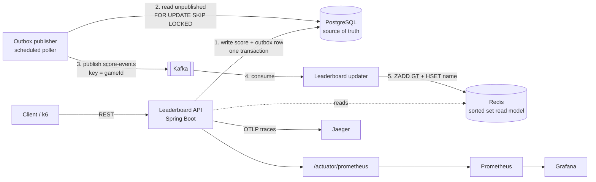

# Player Session & Leaderboard Microservice

[](https://github.com/tanukusaitejesh-prog/player-leaderboard-service/actions/workflows/ci.yml)

A Java 17 / Spring Boot microservice for player sessions and a real-time leaderboard. PostgreSQL is the source of truth, score events reach Kafka through a transactional outbox, and an idempotent consumer maintains a Redis sorted-set read model, so reads never touch the database. It comes with Testcontainers integration tests, a coverage gate in CI, Prometheus metrics, a Grafana dashboard, OpenTelemetry traces in Jaeger, and k6 load tests.



The trade-offs are in [docs/DESIGN.md](docs/DESIGN.md) and the load test results are in [docs/PERFORMANCE.md](docs/PERFORMANCE.md).

## Quickstart

You need Docker. These commands start the whole stack, then run an end-to-end check against it:

```bash
cp .env.example .env
docker compose --profile app up -d --build
./scripts/smoke.sh
```

On Windows, use `Copy-Item .env.example .env` and `./scripts/smoke.ps1`. `smoke.sh` needs `curl` and `jq`.

To run the app from your IDE instead, start only the infrastructure with `docker compose up -d`. Then run `./mvnw spring-boot:run` with `DB_USERNAME`, `DB_PASSWORD` and the database name matching `.env`. On the host, Kafka is at `localhost:29092`.

## API

The base path is `/api/v1`. Errors are RFC 7807 `ProblemDetail` JSON.

| Endpoint | What it does |
|---|---|
| `POST /players` | Creates a player. 409 if the username is taken. |
| `GET /players/{id}` | Gets a player. |
| `POST /sessions` | Starts a session for a player and game. |
| `POST /sessions/{id}/end` | Ends a session. Safe to repeat. |
| `POST /scores` | Submits a score. Needs an `Idempotency-Key` header. 201 on first submit, 200 with the original score on a repeat. |
| `GET /leaderboards/{gameId}/top?limit=10` | Top players by best score, `limit` 1–100. |
| `GET /leaderboards/{gameId}/players/{playerId}` | A player's rank and score, or 404. |
| `POST /admin/leaderboards/{gameId}/rebuild` | Rebuilds the Redis board from PostgreSQL. |

```bash
API=http://localhost:8080/api/v1

PLAYER=$(curl -s $API/players -H 'Content-Type: application/json' \
  -d '{"username":"neo_1"}' | jq -r .id)

SESSION=$(curl -s $API/sessions -H 'Content-Type: application/json' \
  -d "{\"playerId\":\"$PLAYER\",\"gameId\":\"tetris\"}" | jq -r .id)

curl -s $API/scores -H 'Content-Type: application/json' -H 'Idempotency-Key: run-1' \
  -d "{\"playerId\":\"$PLAYER\",\"sessionId\":\"$SESSION\",\"points\":4200}"

curl -s "$API/leaderboards/tetris/top?limit=10"
```

The same thing in PowerShell:

```powershell
$api = 'http://localhost:8080/api/v1'
$player = Invoke-RestMethod "$api/players" -Method Post -ContentType 'application/json' -Body '{"username":"neo_2"}'
$session = Invoke-RestMethod "$api/sessions" -Method Post -ContentType 'application/json' -Body (@{ playerId = $player.id; gameId = 'tetris' } | ConvertTo-Json)
Invoke-RestMethod "$api/scores" -Method Post -ContentType 'application/json' -Headers @{ 'Idempotency-Key' = 'run-2' } -Body (@{ playerId = $player.id; sessionId = $session.id; points = 4200 } | ConvertTo-Json)
Invoke-RestMethod "$api/leaderboards/tetris/top?limit=10"
```

The board updates a moment after the 201, because the update travels through the outbox and Kafka.

## Tests

```bash
./mvnw verify
```

This runs unit and `@WebMvcTest` slice tests with Surefire, and `*IT` integration tests with Failsafe against real PostgreSQL, Redis and Kafka containers, so Docker must be running. It then enforces the coverage rule: at least 80% line and 70% branch, merged across both test runs. The HTML report is at `target/site/jacoco/index.html`.

Coverage excludes only these:

- `LeaderboardApplication`, the main class
- `config/**`, the Spring configuration
- `**/dto/**`, the request and response records

The CI workflow also checks formatting with Spotless (`./mvnw spotless:check`) and runs the smoke script against a stack started from cold.

## Observability

```bash
# Set OTLP_EXPORT_ENABLED=true in .env first, so traces reach Jaeger
docker compose --profile app --profile observability up -d --build
```

| Tool | URL | What to look at |
|---|---|---|
| Grafana | http://localhost:3000 | The provisioned "Leaderboard Service" dashboard (anonymous view is on) |
| Jaeger | http://localhost:16686 | Service `player-leaderboard-service`, operation `http post /api/v1/scores` |
| Prometheus | http://localhost:9090 | Raw metrics |

One `POST /scores` is one trace: HTTP request → `score.persist` → `outbox.publish` → Kafka send → Kafka receive. Getting that across the outbox's thread gap takes a `trace_parent` column on the outbox row.

Custom metrics are `leaderboard.scores.submitted`, `leaderboard.read.duration`, `outbox.pending`, `outbox.publish.failures`, `leaderboard.consumer.processed` and `leaderboard.consumer.deadlettered`. Logs include trace and span ids, and they're JSON under the `docker` profile.

## Load test

```bash
docker run --rm -i --add-host=host.docker.internal:host-gateway \
  -e BASE_URL=http://host.docker.internal:8080 -e RATE=500 \
  grafana/k6:1.8.2 run - < loadtest/k6-leaderboard.js
```

The [Evidence workflow](.github/workflows/evidence.yml) does this on a GitHub runner and saves the raw results, which are in [docs/evidence](docs/evidence).

## What I would do next

- Add a circuit breaker on Redis reads, with a bounded PostgreSQL fallback.
- Add authentication, starting with the admin rebuild endpoint, plus per-client rate limiting.
- Add a retention job for published outbox rows.
- Build a tool to replay `score-events.DLT`.
- Key Kafka by `playerId` if one game gets hot, which `ZADD GT` makes safe.
- Add a Kubernetes manifest set with the existing health probes.
