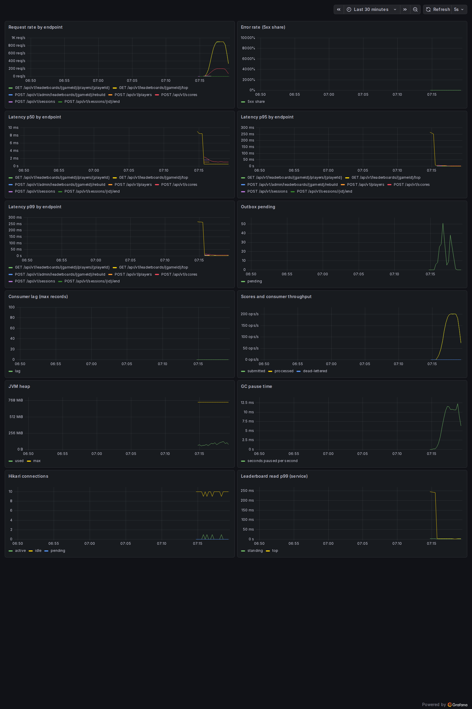

# Performance

All numbers come from k6 runs saved in [`docs/evidence/`](evidence). Each configuration ran 3 times, and the tables report the median with the range across runs.

## Where this ran

| | |
|---|---|
| Machine | GitHub Actions `ubuntu-latest` runner: 4 vCPU AMD EPYC 7763, 16 GB RAM, Linux, Docker 29.4.2 |
| Layout | App, PostgreSQL, Redis, Kafka, Prometheus, Grafana, Jaeger and k6 all on that one machine, in Docker |
| App container | 1 GB limit, Hikari pool of 10, 100% trace sampling exported to Jaeger |
| Workload | 500 players, 45% `GET top?limit=10`, 45% rank lookup, 10% `POST /scores` with a unique key |
| Executor | `ramping-arrival-rate`: 60 s ramp, then steady state |

The load generator competes with the service for the same 4 CPUs, and it's a shared CI machine, so treat these numbers as a floor rather than a production claim. Only steady-state requests (`steady:yes` in k6) are counted, which excludes setup and the ramp.

## Result: 2000 iterations/s for 180 s

The p99 threshold was set to 150 ms after exploratory runs showed 93 ms at this rate, then verified here.

| Metric | Median | Run 1 / 2 / 3 |
|---|---|---|
| Throughput | **1998 req/s** | 1998 / 1997 / 1999 |
| p50 | 0.98 ms | 1.21 / 0.98 / 0.98 |
| p95 | 7.10 ms | 9.89 / 7.10 / 6.67 |
| p99 | **18.99 ms** | 30.85 / 18.99 / 15.12 |
| Failed requests | 0% | 0 / 0 / 0 |
| k6 dropped iterations | 458 | 458 / 472 / 147 (of about 360,000) |

Run 1 is the slowest because it starts on a cold JVM. The runs happen back to back without a restart.

During these runs:

- `outbox.pending` peaked at 111 rows and kept returning to near zero, so the publisher kept up.
- Consumer lag peaked at 0 in Prometheus. That metric is sampled every 5 seconds, so it means no sustained lag, not that lag never existed for an instant.
- `outbox.publish.failures` and `leaderboard.consumer.deadlettered` stayed at 0.
- Hikari pending connections peaked at 0, so the pool of 10 wasn't a limit.



This screenshot is from a separate one-run check at the same rate, taken after I fixed the error-rate panel's query. The tables come from the three runs. That check measured a p99 of 5.27 ms on a different runner, and I don't report it as the result. It shows how much shared runners vary, so a difference of a few milliseconds between runs here doesn't mean much.

## Bottleneck found: a new Redis connection on every rank lookup

**What I saw.** My first exploratory run at 1500 iterations/s had about 10% failed requests and a p99 of about 1 s. The failures were all rank lookups, and the app logs were full of this:

```
java.net.BindException: Cannot assign requested address
```

That error means the machine is out of ephemeral TCP ports. The rank lookup used `executePipelined` for `ZREVRANK` and `ZSCORE`. Spring Data's Lettuce integration shares one connection for normal commands, but a pipeline needs a dedicated one, and with no pool configured that means opening a new TCP connection per call. Each closed connection then sits in `TIME_WAIT`, so high rates run out of ports.

**What I changed.** The two commands now run in one Lua script on the shared connection. It's still a single round trip, and it's now also atomic. A connection pool would also have worked, but it adds a dependency and tuning when the script needs neither. An integration test now checks that 100 lookups don't open new Redis connections.

**Before and after, 1000 iterations/s for 120 s**, with the same stack and only the lookup code changed:

| Metric | Before (pipeline) | After (Lua script) |
|---|---|---|
| Throughput | 997 req/s | 1000 req/s |
| p50 | 2.66 ms (2.22–3.35) | 0.37 ms (0.35–0.38) |
| p95 | 144.58 ms (55.27–160.41) | 1.93 ms (1.44–2.08) |
| p99 | 357.57 ms (180.82–424.99) | 4.14 ms (3.40–4.43) |
| Failed requests | 0.42% (0.39–0.60) | 0% |
| App CPU peak (100% = one core) | 253% | 72% |

The "before" code ran from a temporary branch (the commit in `before-fix-1000/machine.txt`) that was the final code with only `RedisLeaderboardStore` put back to its pipeline version, which is in `main`'s history at `c5fc650`. The `before-fix-1000` runs didn't save app logs, because their workflow succeeded. The `BindException` evidence comes from the 1500/s run ([count and message](evidence/explore-1500/bind-exception-count.txt)).

## Where it saturates now

Exploratory single runs, 120 s each. **These ran before I fixed a Jaeger problem** (see the next section), so they only show the rough shape and aren't comparable with the tables above.

| Target | Achieved | p99 | Failed | Notes |
|---|---|---|---|---|
| 1500/s, before the fix | 1231 req/s | 1014 ms | 10.02% | Port exhaustion |
| 2000/s, after the fix | 1998 req/s | 93 ms | 0% | Basis for the 150 ms threshold |
| 3000/s, after the fix | 2773 req/s | 314 ms | 0% | 29,728 dropped iterations, consumer lag up to 5471 |

At 3000/s the whole machine is the limit: system CPU reached 99%, with the app, Kafka and k6 all competing for it. Hikari pending also rose to 8 there. On hardware where k6 ran elsewhere, I'd expect the next real limits to be the write path, meaning PostgreSQL commits and the outbox publisher's batch of 100 per 200 ms poll.

## A measurement problem I had to fix

The first version of these runs was wrong. Jaeger's in-memory store is unbounded by default, and at 100% sampling it reached its 512 MB container limit partway through, in every configuration. Span exports started failing, so the app was doing less work in later runs than in earlier ones. Those runs had p99s of 79 / 12 / 9 ms at 2000/s, which looked better than the real numbers and weren't comparable with each other.

I capped Jaeger with `MEMORY_MAX_TRACES=20000` and reran everything. In the final runs Jaeger stayed around 150 MB and `span-export-failures.txt` shows 0 failures. I also found a k6 script bug early on, where each virtual user read a different empty board, and those numbers were thrown away too.

## Reproducing this

`Evidence` is a manual GitHub Actions workflow in [`.github/workflows/evidence.yml`](../.github/workflows/evidence.yml):

```bash
gh workflow run Evidence -f label=final-2000 -f rate=2000 -f runs=3 -f steady_seconds=180 -f p99_target_ms=150
```

The steady req/s is `http_reqs{steady:yes}.count / steady_seconds` from each `k6-run-N.json`.
